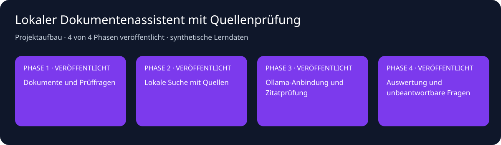

# Lokaler Dokumentenassistent mit Quellenprüfung

Eine passende Anweisung soll in drei Dokumenten gefunden werden. Antworten müssen ihre Quelle belegen oder eine fehlende Grundlage deutlich machen.



**Veröffentlichungsstand: Phase 4/4.** Dieses eigenständige Repository übernimmt zunächst den bereits lokal committeten Stand. Weitere fachliche Phasen werden im Abstand von mindestens vier Stunden veröffentlicht. Die technische Entwicklung und die öffentliche Veröffentlichung haben unterschiedliche echte Zeitpunkte.

## Was hier zu sehen ist

| Schritt | Inhalt | Hier veröffentlicht |
|---|---|---|
| 1 | Dokumente und Prüffragen | Ja |
| 2 | Lokale Suche mit Quellen | Ja |
| 3 | Ollama-Anbindung und Zitatprüfung | Ja |
| 4 | Auswertung und unbeantwortbare Fragen | Ja |

## Fachlicher Nutzen

LLM-Anbindung, Quellenprüfung, Fehlerrückhaltung und nachvollziehbare Auswertung.

## Lokal starten

Im geklonten Repository ausführen; die benötigte Laufzeit muss installiert sein. Python-Beispiele verwenden 3.12, Node-Beispiele 24 und C# die im Projekt angegebene .NET-Version. Befehle mit uv laden die dort genau bezeichneten Pakete bei Bedarf.

```powershell
python -X utf8 nachweise/P03-T03-pruefung.py
python -X utf8 nachweise/P03-T04-auswertung.py
```

Ausführliche technische Befehle: [START.md](START.md). [Öffentlicher Prüfstand](ABNAHME.json) und [Quellphasen](VERLAUF.json) dokumentieren Herkunft und echte Ausführungsdaten. Eine neue Repositorykopie ist kein neuer nativer Desktoplauf.

## Ergebnis des lokal geprüften Schlussstands

9 von 10 Quellenzuordnungen; beide unbeantwortbaren Fragen zurückgehalten. Diese kleine Stichprobe ist keine allgemeine Qualitätsgarantie.

## Grenzen

Ollama mit qwen2.5:1.5b wird lokal benötigt; kein MCP und keine Vektordatenbank.

Eigenes kleines Lernprojekt mit synthetischen Daten, mit KI-Unterstützung entwickelt und geprüft. Keine Aussage über Berufserfahrung, menschliche Arbeitsstunden oder praktische Verwendung weiterer nur geplanter Produkte.
